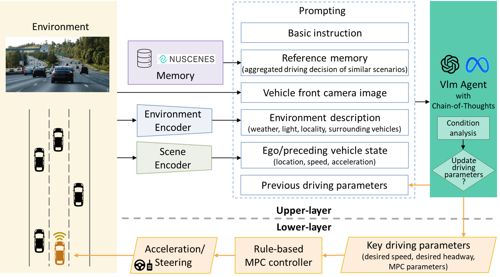

# VLM-MPC

**VLM-MPC: Model Predictive Controller Augmented Vision Language Model for Autonomous Driving**

Keke Long, Haotian Shi, Jiaxi Liu, Chaowei Xiao, and Xiaopeng Li  
*Transportation Research Part C: Emerging Technologies*, Volume 183, Article 105487 (2026).

**[Paper (Publisher)](https://doi.org/10.1016/j.trc.2025.105487) | [Author-version PDF](assets/paper/VLM-MPC_TRC_2026.pdf) | [Source Code](https://github.com/Keke-Long/VLM-MPC)**

## Key Contributions

- **Hierarchical decision-making and control:** An asynchronous framework where a vision-language model generates driving parameters and a model predictive controller executes real-time, dynamics-aware control.
- **Context-aware driving decisions:** An environment encoder and reference memory supply scene context to support the VLM's parameter selection.
- **Closed-loop evaluation:** Experiments on nuScenes and CARLA assess safety, smoothness, and response stability in challenging driving scenarios.

## Overview



VLM-MPC is a closed-loop autonomous driving framework that integrates a Vision-Language Model (VLM) with Model Predictive Control (MPC) through a two-level asynchronous architecture:

- **Upper-level VLM:** Interprets driving scenes and generates key driving parameters, including desired speed and desired headway, using front-camera images, ego-vehicle states, environmental conditions, and reference memory.
- **Lower-level MPC:** Uses these parameters for real-time vehicle control while accounting for vehicle dynamics and engine lag, and provides state feedback to the overall system.

The framework is evaluated using nuScenes and CARLA under challenging driving conditions, including night, rain, fog, and intersections.

## Repository Structure

The repository includes materials for:

- **VLM-based decision making**: VLM/LLM controllers and scene reasoning.
- **Model Predictive Control**: MPC calibration and lower-level vehicle control.
- **Data preparation**: Processing of scene, image, and vehicle-state data.
- **Image processing**: Preparation of visual inputs for the VLM.
- **Evaluation**: Safety, smoothness, and response-stability evaluation.
- **Baseline comparison**: Materials for comparison with Agent-Driver and related baselines.
- **Example scenes and figures**: Sample inputs and framework illustrations.

## Installation

Create a Python environment and install the listed dependencies:

```bash
git clone https://github.com/Keke-Long/VLM-MPC.git
cd VLM-MPC
pip install -r requirements.txt
```

Some components may require access credentials for external model APIs. Users should provide their own credentials through environment variables or local configuration and should not commit credentials to the repository.

## Citation

If you use this repository, please cite:

```bibtex
@article{long2026vlmmpc,
  title={VLM-MPC: Model predictive controller augmented vision language model for autonomous driving},
  author={Long, Keke and Shi, Haotian and Liu, Jiaxi and Xiao, Chaowei and Li, Xiaopeng},
  journal={Transportation Research Part C: Emerging Technologies},
  volume={183},
  pages={105487},
  year={2026},
  doi={10.1016/j.trc.2025.105487}
}
```

## License

This project is released under the [Apache License 2.0](LICENSE).
